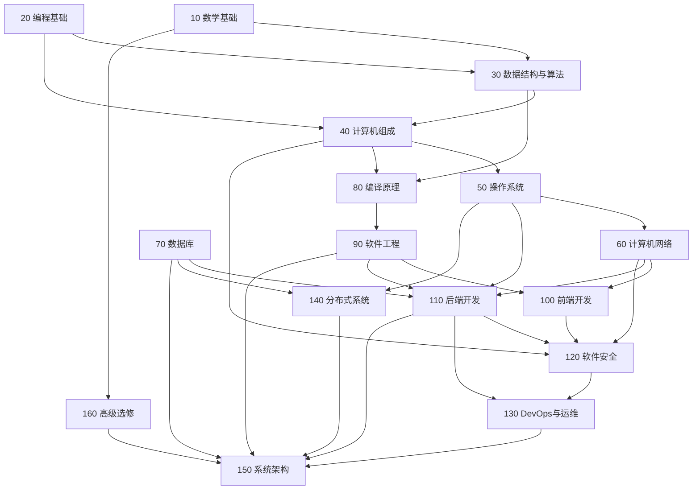

# 计算机科学知识地图

> 本文件是整个知识库的**总纲**。16 个知识领域各有一个目录，目录内固定三份文件：
> `00-领域总览.md`（定位与边界）、`01-知识点目录.md`（知识点清单）、`02-权威课程与资料.md`（可核实的外部来源）。
>
> 已有材料不迁移：原来的四门 CMU 课程笔记保留在原位，本页用「衔接」一列指过去。

---

## 一、16 个知识领域

| 编号 | 领域 | 目录 | 这个领域回答什么问题 |
| --- | --- | --- | --- |
| 10 | 数学基础 | [10-数学基础](10-数学基础/00-领域总览.md) | 证明怎么写？复杂度怎么算？概率怎么建模？ |
| 20 | 编程基础 | [20-编程基础](20-编程基础/00-领域总览.md) | 怎么把一个想法变成能跑的程序？ |
| 30 | 数据结构与算法 | [30-数据结构与算法](30-数据结构与算法/00-领域总览.md) | 什么样的数据组织与求解策略是"足够快"的？ |
| 40 | 计算机组成 | [40-计算机组成](40-计算机组成/00-领域总览.md) | 一行代码在机器层面到底发生了什么？ |
| 50 | 操作系统 | [50-操作系统](50-操作系统/00-领域总览.md) | 多个程序如何安全、公平地共享一台机器？ |
| 60 | 计算机网络 | [60-计算机网络](60-计算机网络/00-领域总览.md) | 两台机器之间如何可靠地传字节？ |
| 70 | 数据库 | [70-数据库](70-数据库/00-领域总览.md) | 数据如何持久化、并发、可查询？ |
| 80 | 编译原理 | [80-编译原理](80-编译原理/00-领域总览.md) | 文本如何变成可执行语义？ |
| 90 | 软件工程 | [90-软件工程](90-软件工程/00-领域总览.md) | 多人长期维护的代码如何不腐化？ |
| 100 | 前端开发 | [100-前端开发](100-前端开发/00-领域总览.md) | 界面如何被构建、渲染、交互？ |
| 110 | 后端开发 | [110-后端开发](110-后端开发/00-领域总览.md) | 服务如何承载业务、连接存储、对外提供 API？ |
| 120 | 软件安全 | [120-软件安全](120-软件安全/00-领域总览.md) | 系统在对手存在时如何仍然正确？ |
| 130 | DevOps与运维 | [130-DevOps与运维](130-DevOps与运维/00-领域总览.md) | 代码如何稳定、可重复地到达生产环境？ |
| 140 | 分布式系统 | [140-分布式系统](140-分布式系统/00-领域总览.md) | 多台机器如何表现得像一台？ |
| 150 | 系统架构 | [150-系统架构](150-系统架构/00-领域总览.md) | 在约束下如何做技术选型与权衡？ |
| 160 | 计算机高级选修 | [160-计算机高级选修](160-计算机高级选修/00-领域总览.md) | AI / 图形学 / PL / 体系结构等专门方向 |

---

## 二、依赖关系



读法：箭头 A → B 表示「学 B 之前，A 的内容会被反复用到」。

- **地基三件套**：数学基础、编程基础、数据结构与算法。缺任何一个，后面的课都会变成背结论。
- **系统三件套**：计算机组成 → 操作系统 → 计算机网络。这三门是「为什么慢 / 为什么会挂」的答案来源。
- **工程三件套**：数据库、软件工程、后端开发。这三门是「能不能交付」的答案来源。
- **汇聚层**：系统架构不引入新知识，只做权衡；没学过前面 15 个领域时读架构书，只能记住名词。

---

## 三、三条学习主线

不同目标不必走完 16 个领域，但**主干不能跳过**。

### 主线 A：系统方向（读研 / 基础软件 / 后端基础设施）

```
10 数学基础 → 20 编程基础 → 30 数据结构与算法
   → 40 计算机组成 → 50 操作系统 → 60 计算机网络
   → 70 数据库 → 140 分布式系统 → 150 系统架构
分支：80 编译原理、120 软件安全、130 DevOps
```

### 主线 B：应用 / 全栈方向（求职 / 独立开发）

```
20 编程基础 → 30 数据结构与算法 → 90 软件工程
   → 100 前端开发 → 110 后端开发 → 70 数据库
   → 130 DevOps → 150 系统架构
补课：50 操作系统（进程/内存/IO）+ 60 计算机网络（HTTP/TCP）
```

### 主线 C：算法 / AI 方向

```
10 数学基础（线代、概率、微积分）→ 30 数据结构与算法
   → 160 计算机高级选修（机器学习 → 深度学习 → 专门方向）
补课：40 计算机组成（GPU / 并行）+ 140 分布式系统（训练与推理工程）
```

---

## 四、与原四门 CMU 课程的衔接

原有笔记**位置不变**，只是在这里登记它们归入哪个领域：

| 原目录 | 课程 | 归入领域 | 知识点覆盖 | 说明 |
| --- | --- | --- | --- | --- |
| `10-CMU-15-122/` | 15-122 Principles of Imperative Computation（Fall 2026） | 30 数据结构与算法 | [47 点 → ✅19 / ⚠3 / ❌25](30-数据结构与算法/03-已有笔记索引.md) | C0 前 9 周、标准 C 后 5 周 |
| `20-CMU-15-213/` | 15-213 Introduction to Computer Systems（Fall 2026） | 40 计算机组成 | [37 点 → ✅27 / ⚠1 / ❌9](40-计算机组成/03-已有笔记索引.md) | 与 50 操作系统相邻 |
| `30-CMU-15-214/` | 15-214 Principles of Software Construction（**Fall 2013**） | 90 软件工程 | [39 点 → ✅14 / ⚠8 / ❌17](90-软件工程/03-已有笔记索引.md) | 版本较旧，注意年代 |
| `40-CMU-15-445/` | 15-445 Database Systems（Fall 2026，C++17 先修） | 70 数据库 | [45 点 → ✅34 / ⚠4 / ❌7](70-数据库/03-已有笔记索引.md) | F26 资料仅校内，已用 Fall 2025 公开视频按主题映射 |

**「知识点覆盖」一列**是该领域 `03-已有笔记索引.md` 的链接：把 `01-知识点目录.md` 的每个知识点逐条对到现有笔记，标出 ✅ 已覆盖 / ⚠ 部分覆盖 / ❌ 空缺。**状态只表示「有没有笔记」，不表示「你掌握没有」** —— 掌握情况看你自己的复选框。

四个领域合计 168 个知识点，现有笔记覆盖 94 个（56%）。空缺主要集中在课程本身不讲的工程实践内容（版本控制、CI/CD、构建系统、处理器微架构、NoSQL），这些需要另外找资料或动手补，读现有笔记补不上。

30 领域的多组 CMU 笔记空缺已由原创笔记补上：**算法设计范式、归并排序、拓扑排序、最短路、Trie**（`04`–`08` 号文件）。这些原创篇目不计入上表的 CMU 覆盖率。

入口见根目录 [02-课程总览](../02-课程总览.md) 与各课 `00-课程总览.md`。

---

## 四之二、C 语言先修库（20 领域 · 15-213 前置）

`docs/programming/c-language/` 是一套独立的 C 语言恢复资料，目标不是「学完 C」，而是**能读 15-213 的机器级代码、能写 `malloclab`**。

| 文件 | 内容 |
| --- | --- |
| [00-C语言学习总览](programming/c-language/00-C语言学习总览.md) | 10 个模块、依赖关系、资料边界 |
| [01](programming/c-language/01-基础语法.md)–[09](programming/c-language/09-GDB与Valgrind.md) | 九个模块笔记 |
| [10-综合练习](programming/c-language/10-综合练习.md) | `memtool` 多文件项目 |
| [11-八天复习路线](programming/c-language/11-八天复习路线.md) | 每天看什么、做什么、怎么算通过 |
| [12-CMU-15-213先修评估](programming/c-language/12-CMU-15-213先修评估.md) | 20 项能力检查表 |
| [13-术语词典](programming/c-language/13-术语词典.md) | 英文术语与统一译名 |
| [00-资料来源清单](programming/c-language/00-资料来源清单.md) | 8 个官方链接与核验结果 |
| [14-资料完整性检查报告](programming/c-language/14-资料完整性检查报告.md) | 13 项质量验收与实测结果 |

**瓶颈是 03 指针与 05 内存管理。** 其余模块可在 15-213 里边学边补。

---

## 五、使用方式

1. **先读领域总览**：`00-领域总览.md` 说明这个领域的边界，以及它**不**负责什么。
2. **再读知识点目录**：`01-知识点目录.md` 是可勾选的清单，条目粒度是「能独立讲清的一个概念」。
3. **最后选课**：`02-权威课程与资料.md` 只列经 `scripts/verify_urls.py` 实测可达的公开来源。
4. **学完写笔记**：原创笔记进 `docs/<领域>/`（可公开）或 `personal-notes/`（私有），二选一，规则见 [sources/03-许可判定规则.md](../sources/03-许可判定规则.md)。

> 知识点目录里的 `[ ]` 是 Obsidian 与 GitHub 都认的复选框，可直接当进度表用。
